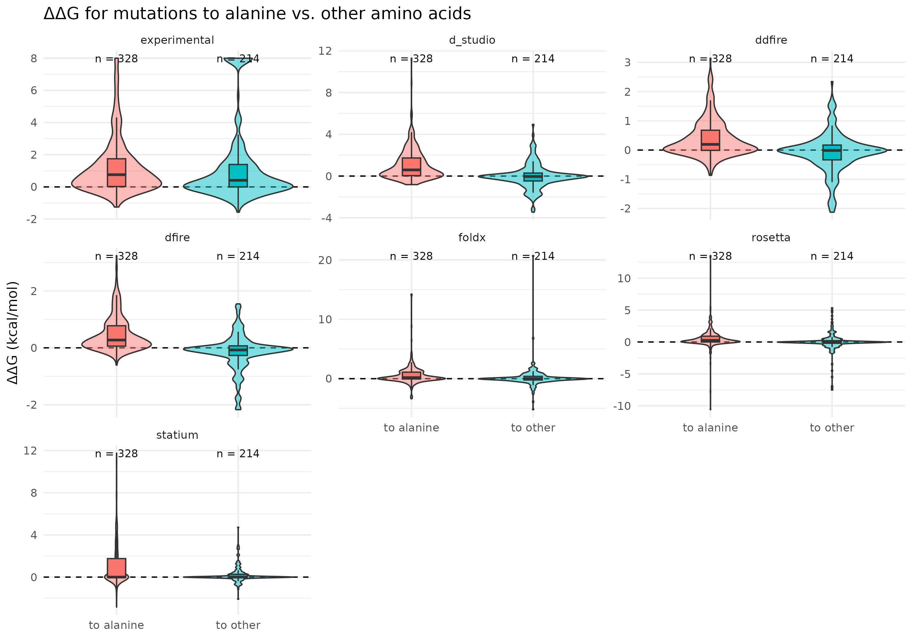
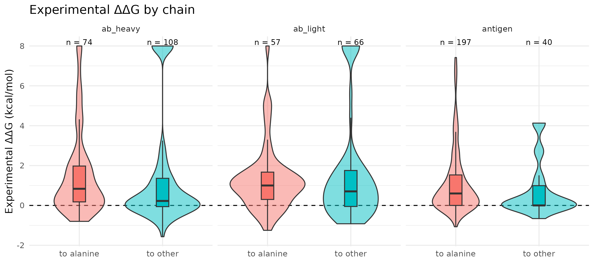

## How do mutations change binding?

**Group 10 · AB-Bind**

- How well do computational methods rank mutations by their effect on binding?
- Which starting residues show the biggest change when replaced with alanine?

**Positive ΔΔG means weaker binding.**

::: {.notes}
**Thota · 0:55**

We looked at how mutations change binding in antibody complexes. A positive experimental ΔΔG means binding got weaker after the mutation. We asked two questions. First, if we only had computational predictions, would they put the mutations in roughly the same order as the experiment? Second, looking at the experimental measurements, what happens when we replace different amino acids with alanine? Luis will come back to why we grouped the starting residues by chemistry.
:::

## Materials — What’s in AB-Bind?

- 1,101 experimental mutation records across 32 complexes.
- Predictions from six computational methods.
- PDB IDs and mutation labels to link the two sources.

[AB-Bind paper](https://pmc.ncbi.nlm.nih.gov/articles/PMC4815335/) · [Source data](https://github.com/sarahsirin/AB-Bind-Database)

::: {.notes}
**Thota · 1:05**

AB-Bind gives us experimental measurements and computational predictions. The experimental file also tells us which complex and mutation each measurement belongs to. The prediction files give scores for those mutations, although coverage can differ by method. The raw data includes cases where several amino acids were changed together. That matters for the alanine question because we want to link each result to a single starting residue. I’ll hand over to Luis to explain how we prepared the files.
:::

## Methods — From raw files to analysis data

```{mermaid}
flowchart LR
    A["Experimental data"] --> B["Keep single substitutions in selected complexes"]
    C["Prediction files"] --> D["Average duplicate predictions per method"]
    B --> E["Join by PDB ID and mutation"]
    D --> E
    E --> F["Standardise chains and add mutation features"]
```

::: {.notes}
**Luis · 0:45**

We started with the experimental table and the prediction files. On the experimental side we kept single substitutions in the complexes we selected. For predictions that appeared more than once for the same method and mutation, we took their mean. We joined the files using both the PDB ID and the mutation label, because the same label can occur in different complexes. We then standardised chain names and added the mutation features we needed later.
:::

## Methods — Two questions, two datasets

| Prediction comparison | Alanine analysis |
|---|---|
| Same measurements for all six methods | Experimental measurements for substitutions to alanine |
| Spearman correlation and one linear fit per method | Mean ΔΔG by starting residue, then by chemical group |
| Compare ranking and how much variation the fits explain | Account for mutation location and PDB ID |

::: {.notes}
**Luis · 0:45**

For Analysis 1 we used the same subset for all methods so differences in coverage would not decide the ranking. We looked at Spearman correlation for ranking and used the linear fits to see how much variation each method accounted for. For Analysis 2 we only needed the experimental alanine measurements. We looked at individual residues first, then compared the chemical groups while accounting for location and complex.
:::

## Describe — What did the data look like?

**542 measurements · 540 variants · 23 complexes**

::: {.r-stack}

{{.fragment .fade-out data-fragment-index="0" height="480px"}}

{.fragment .current-visible data-fragment-index="0" width="94%"}

:::

::: {.notes}
**Laura · 1:10**

**First plot · 25 seconds**

We first compared mutations to alanine with mutations to other amino
acids. Each panel shows the same 328 alanine and 214 other measurements.
Start with the experimental panel, then point out that the predicted
distributions also vary between methods.

**Click to show the chain plot · 45 seconds**

Then we split the experimental values by mutation location. On the
antigen, the median was higher for alanine substitutions. We also had
more alanine measurements there, 197 compared with 40 for other
substitutions. This gives us an overview of the data before Taniya
shows how well the predictions matched the experiments for individual
mutations.
:::


## Analysis 1 — Predicted vs. experimental ΔΔG

{width=77%}

::: {.notes}
**Taniya · 1:10**

Each panel shows one computational method, and each point compares a prediction with the experimental measurement for that mutation. Look at the spread around the fitted lines. Even when the slope is positive, the values can still be quite scattered. The row at +8 is a group of 26 values recorded at the same point in the original data.
:::

## Analysis 1 — How well did the methods rank mutations?

{width=80%}

**The methods gave a rough ranking of mutation effects.**

::: {.notes}
**Taniya · 1:20**

Spearman correlation tells us whether higher predicted effects tend to go with higher experimental effects. Discovery Studio had the highest observed correlation, about 0.32, followed by FoldX at about 0.27. The correlations were still weak. The highest R squared was about 7%, for FoldX. The intervals show the uncertainty around each estimate. We did not run a direct test comparing the correlations between methods, so keep the claim to their observed ranking. The first analysis looked at how well we can predict the experimental measurements. Laura will now take us through what the measured alanine substitutions show.
:::

## Analysis 2.1 — Which starting residues had higher ΔΔG?

PLOT HERE

Dot size shows the number of measurements. Colour shows the chemical group.

::: {.notes}
**Laura · 1:20**

Here we only look at substitutions to alanine. Each point is the mean for one starting amino acid. The lines show 95% confidence intervals where we have more than one measurement. A residue can be high on the plot because of a single large value, so look at the dot size before interpreting the ranking. Cysteine had the highest observed mean, but it was measured once. Tryptophan averaged 2.52 across 12 measurements, while tyrosine averaged 1.86 across 47. That leads into the next question. Do we still see differences when we compare chemical groups and account for where the mutations were measured?
:::

## Analysis 2.2 — Did chemical group help explain ΔΔG?

**Model comparison:** Add chemical group to a model with mutation location and PDB ID.

| Comparison | Adjusted difference | Holm-adjusted p |
|---|---:|---:|
| Aromatic − polar | +0.98 kcal/mol | 0.0014 |
| Positive − polar | +0.79 kcal/mol | 0.028 |

::: {.notes}
**Luis · 1:00**

Both models included mutation location and PDB ID. We added the starting residue’s chemical group to the second model and checked whether the fit improved. The pairwise comparisons show which groups differed and by how much. Aromatic-to-alanine substitutions averaged about 0.98 kcal/mol higher than polar-to-alanine substitutions after adjustment. The positive–polar difference was about 0.79 kcal/mol. Adding chemical group accounted for roughly 6% of the variation left after accounting for chain location and PDB ID.
:::

## What did we learn?

- Computational scores gave a rough ranking of mutation effects.
- Starting-residue chemistry helped explain some of the measured differences for alanine substitutions.

::: {.notes}
**Thota · 0:30**

The computational methods picked up some of the pattern, but the rankings were weak. In the alanine analysis, chemical group helped explain some of the differences after we accounted for mutation location and PDB ID. The aromatic–polar comparison was the clearest example. We would be more cautious about individual residues that had very few measurements.
:::
