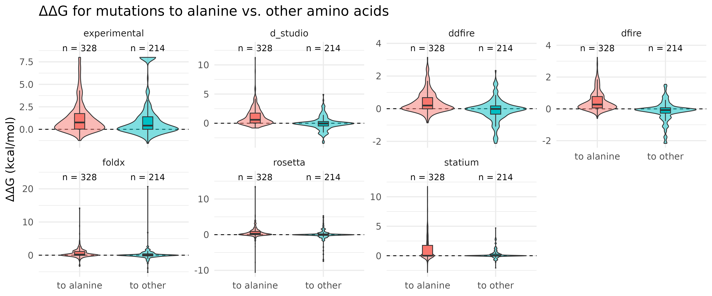
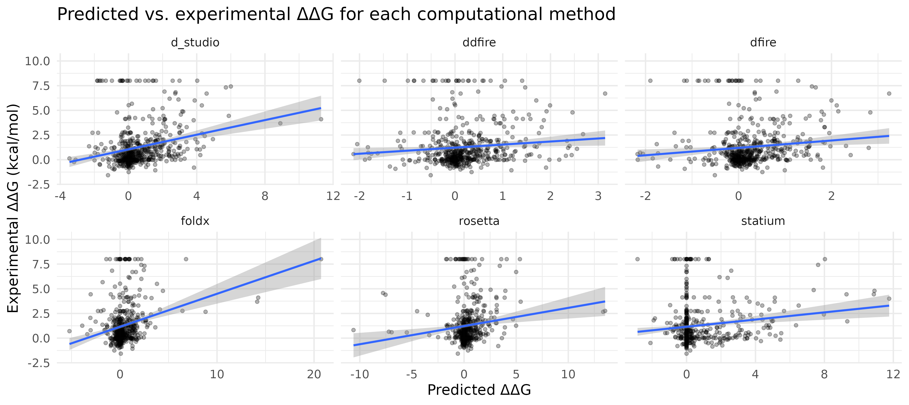
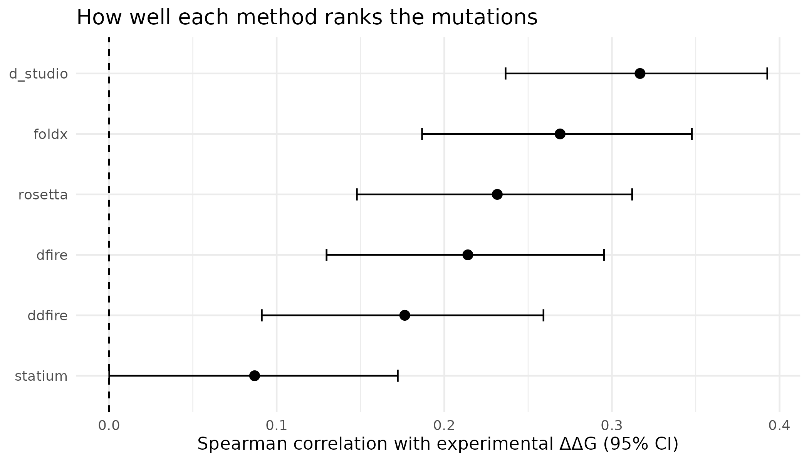
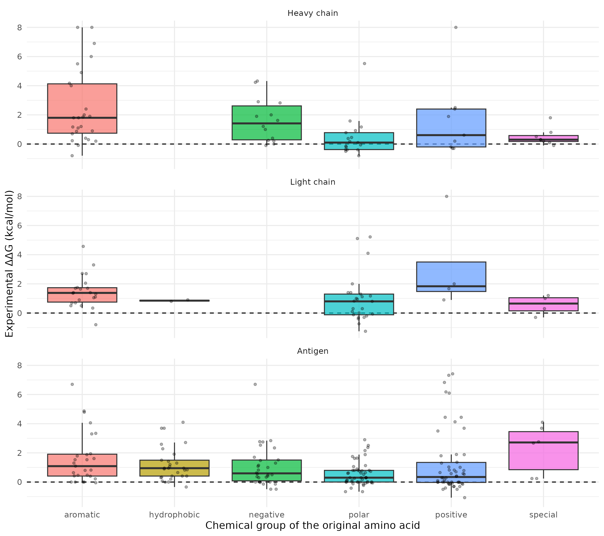

## How do mutations change binding? {.opening background-color="#17283c"}

::: {.two-up}
::: {.question}

Can we predict the ranking?

Do computational scores put mutations in roughly the same order as the experiment?
:::

::: {.question}

What happens when we substitute alanine?

Which starting residues tend to give the largest changes in binding?
:::
:::

::: {.sign}
**Positive ΔΔG means weaker binding after mutation.**
:::

::: {.credits}
Group 10 · AB-Bind

Luis Sebastian Galán, Laura Grenaa Jensen, Taniya Dey and Thota Kanishka Rao
:::

## Materials · What’s in AB-Bind? {.text-slide}

::: {.three-up}
::: {.stat}
**1,101**

Experimental mutation records
:::

::: {.stat}
**32**

Complexes in the source dataset
:::

::: {.stat}
**6**

Computational methods in our comparison
:::
:::

::: {.note-line}
Each record links a mutation to a complex. Some records contain multiple substitutions.
:::

::: {.source}
[Sirin et al., *Protein Science* (2016)](https://pubmed.ncbi.nlm.nih.gov/26473627/) · [AB-Bind source data](https://github.com/sarahsirin/AB-Bind-Database)
:::

## Methods · From raw files to analysis data {.text-slide}

::: {.three-up}
::: {.step}

Select mutations

Keep single substitutions in the selected complexes.
:::

::: {.step}

Match predictions

Average duplicate predictions within each method. Join by **PDB ID and mutation label**.
:::

::: {.step}

Add mutation features

Standardise chain labels and identify mutation location, alanine substitutions, and starting-residue chemistry.
:::
:::

::: {.note-line .capped}
**+8 kcal/mol is a capped value.** We kept these measurements at the recorded cap.
:::

## Methods · How did we analyse the data? {.text-slide}

::: {.two-up}
::: {.question}

1 · Prediction performance

- **Spearman correlation** to compare predicted and experimental rankings
- **Linear regression and R²** to assess how much variation each method explained

We used the same measurements for all six methods.
:::

::: {.question}

2 · Alanine substitutions

- **Means and 95% confidence intervals** by starting amino acid
- **One-way ANOVA** to compare chemical groups
- **Nested-model F-tests** to assess chemistry after adjustment and test interactions
- **Pairwise comparisons** with Holm-adjusted p-values
:::
:::

## Describe · What did the data look like?

**542 measurements · 540 variants · 23 complexes**

ΔΔG tells us how a mutation changes binding. Above 0, binding gets weaker.

::: {.r-stack}

::: {.figure .wide-figure .describe-plot .fragment .fade-out data-fragment-index="0"}

::: {.muted .figure-note}
**328** substitutions to alanine · **214** to other amino acids
:::
:::

::: {.figure .wide-figure .describe-plot .fragment .current-visible data-fragment-index="0"}

::: {.muted .figure-note}
Alanine had the higher median on all three chains. Antigen: **197** to alanine, **40** to others.
:::
:::

:::

## Results 1 · Predictions showed wide scatter

With good predictions, the points would sit close to a line. Here they are quite spread out.

::: {.figure .wide-figure}

:::

::: {.muted .figure-note}
Each panel is one prediction method. In the experimental data, 26 values were recorded at +8 kcal/mol.
:::

## Results 1 · The methods ranked mutations weakly

Can the methods put mutations in the right order? Spearman: 1 = perfectly, 0 = no relationship.

::: {.figure-layout}
::: {.figure}

:::

::: {.figure-aside}
::: {.value}
0.32
:::
Discovery Studio had the highest observed Spearman correlation. FoldX followed at **0.27**.

::: {.note-line .muted}
The highest observed R² was about 7% (FoldX).
:::
:::
:::

## Results 2.1 · Tryptophan and tyrosine had high mean ΔΔG

::: {.figure-layout}
::: {.figure}

:::

::: {.figure-aside}
**Tryptophan** · 2.52 kcal/mol (n = 12)

**Tyrosine** · 1.86 kcal/mol (n = 47)

::: {.note-line .muted}
Cysteine had the highest observed mean, based on one measurement.
:::
:::
:::

## Results 2.2 · Chemical groups differed after adjustment

::: {.figure-layout}
::: {.figure}

:::

::: {.figure-aside .results-table}

Adjusted differences

| Compared with polar | ΔΔG difference | Holm p |
|:--------------------|---------------:|-------:|
| Aromatic | +0.98 | 0.0014 |
| Positive | +0.79 | 0.028 |

::: {.muted}
Mean differences in kcal/mol, adjusted for chain location and PDB ID.
:::

::: {.note-line .muted}
Adding chemistry improved model fit (p = 0.0018).
:::
:::
:::

## What did we learn? {.closing background-color="#17283c"}

::: {.two-up}
::: {.question}

Can we predict the ranking?

The six methods picked up some of the pattern. Even the highest observed rank correlation was only **0.32**.
:::

::: {.question}

What happens when we substitute alanine?

Aromatic-to-alanine substitutions had about **1 kcal/mol higher mean ΔΔG** than polar-to-alanine substitutions after adjustment.
:::
:::

